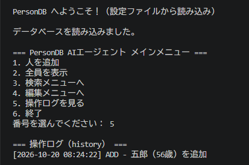

# Python ミニアプリ（Day40）AIエージェント完成版 PersonDB

## 🎉 概要
Day21〜Day40 で構築してきた PersonDB を統合し、
「データベース」「ログ」「設定」「柔軟検索」「自動保存」「階層メニュー」を備えた  
**ミニAIエージェントの原型** が完成しました。

このアプリは、AIエージェントが持つべき基本機能をすべて含んでいます。

- 永続化メモリ（JSON）
- 柔軟検索（完全一致・部分一致）
- 自動保存（auto-save）
- 行動ログ（history）
- 設定管理（config.json）
- 階層メニュー（検索・編集）
- CRUD（追加・表示・検索・更新・削除）

## 🧠 機能一覧
- **追加（ADD）**  
  人物を追加し、自動保存＋ログ記録。

- **表示（LIST）**  
  全員を greet() 付きで表示。

- **検索（SEARCH）**  
  - 完全一致検索  
  - 部分一致検索（複数ヒット）

- **編集（EDIT）**  
  - 名前で削除  
  - 名前で更新  
  どちらも自動保存＋ログ記録。

- **ログ（HISTORY）**  
  history.json に操作履歴を保存し、メニューから閲覧可能。

- **設定（CONFIG）**  
  config.json によりアプリの動作を外部から変更可能。

## 📁 設定ファイル（config.json）
{
  "database_file": "person_db.json",
  "history_file": "history.json",
  "auto_save": true,
  "welcome_message": "PersonDB AIエージェントへようこそ！（設定ファイルから読み込み）"
}
## 📄 完成コード（person_db_agent.py）
import json
from datetime import datetime

# ==============================
# 設定ファイル（config.json）
# ==============================
class Config:
    def __init__(self, filename="config.json"):
        self.filename = filename
        self.data = {}
        self.load()

    def load(self):
        try:
            with open(self.filename, "r", encoding="utf-8") as f:
                self.data = json.load(f)
            print("設定ファイルを読み込みました。\n")
        except FileNotFoundError:
            print("設定ファイルがありません。デフォルト設定を使用します。\n")
            self.data = {
                "database_file": "person_db.json",
                "history_file": "history.json",
                "auto_save": True,
                "welcome_message": "PersonDB AIエージェントへようこそ！（デフォルト設定）"
            }

# ==============================
# Person クラス
# ==============================
class Person:
    def __init__(self, name, age):
        self.name = name
        self.age = int(age)

    def to_dict(self):
        return {"name": self.name, "age": self.age}

    def greet(self):
        return f"こんにちは、{self.name}（{self.age}歳）です！"

# ==============================
# PersonDB（AIエージェント本体）
# ==============================
class PersonDB:
    def __init__(self, config):
        self.filename = config.data["database_file"]
        self.history_file = config.data["history_file"]
        self.auto_save = config.data["auto_save"]

        self.people = []
        self.history = []

    # --- ログ記録 ---
    def log(self, action, detail):
        entry = {
            "time": datetime.now().strftime("%Y-%m-%d %H:%M:%S"),
            "action": action,
            "detail": detail
        }
        self.history.append(entry)
        self.save_history()

    def save_history(self):
        with open(self.history_file, "w", encoding="utf-8") as f:
            json.dump(self.history, f, ensure_ascii=False, indent=2)

    def load_history(self):
        try:
            with open(self.history_file, "r", encoding="utf-8") as f:
                self.history = json.load(f)
        except FileNotFoundError:
            self.history = []

    # --- DB 保存 ---
    def save(self):
        data = [p.to_dict() for p in self.people]
        with open(self.filename, "w", encoding="utf-8") as f:
            json.dump(data, f, ensure_ascii=False, indent=2)
        print("（保存）データベースを保存しました。\n")

    # --- DB 読み込み ---
    def load(self):
        try:
            with open(self.filename, "r", encoding="utf-8") as f:
                data = json.load(f)
                self.people = [Person(item["name"], item["age"]) for item in data]
            print("データベースを読み込みました。\n")
        except FileNotFoundError:
            print("データベースファイルがありません。新規作成します。\n")

    # --- CRUD ---
    def add(self, person):
        self.people.append(person)
        if self.auto_save:
            self.save()
        self.log("ADD", f"{person.name}（{person.age}歳）を追加")

    def find(self, name):
        for p in self.people:
            if p.name == name:
                return p
        return None

    def find_all(self, keyword):
        return [p for p in self.people if keyword in p.name]

    def delete(self, name):
        for p in self.people:
            if p.name == name:
                self.people.remove(p)
                if self.auto_save:
                    self.save()
                self.log("DELETE", f"{name} を削除")
                return True
        return False

    def update(self, name, new_name, new_age):
        person = self.find(name)
        if person:
            old = f"{person.name}（{person.age}歳）"
            person.name = new_name
            person.age = int(new_age)
            new = f"{person.name}（{person.age}歳）"
            if self.auto_save:
                self.save()
            self.log("UPDATE", f"{old} → {new} に更新")
            return True
        return False

# ==============================
# メニュー（階層構造）
# ==============================
config = Config()
db = PersonDB(config)

print(config.data["welcome_message"], "\n")

db.load()
db.load_history()

def show_history():
    print("\n=== 操作ログ（history） ===")
    if not db.history:
        print("ログはまだありません。\n")
        return
    for entry in db.history:
        print(f"[{entry['time']}] {entry['action']} - {entry['detail']}")
    print()

def search_menu():
    while True:
        print("=== 検索メニュー ===")
        print("1. 完全一致検索")
        print("2. 部分一致検索")
        print("3. 戻る")
        choice = input("番号を選んでください： ")

        if choice == "1":
            name = input("検索する名前： ")
            result = db.find(name)
            if result:
                print(result.greet(), "\n")
            else:
                print("見つかりませんでした。\n")

        elif choice == "2":
            keyword = input("検索キーワード： ")
            results = db.find_all(keyword)
            if results:
                print("\n--- 部分一致検索の結果 ---")
                for p in results:
                    print(p.greet())
                print()
            else:
                print("該当する人がいませんでした。\n")

        elif choice == "3":
            break

        else:
            print("無効な入力です。\n")

def edit_menu():
    while True:
        print("=== 編集メニュー ===")
        print("1. 名前で削除")
        print("2. 名前で更新")
        print("3. 戻る")
        choice = input("番号を選んでください： ")

        if choice == "1":
            name = input("削除する名前： ")
            if db.delete(name):
                print("削除しました。\n")
            else:
                print("見つかりませんでした。\n")

        elif choice == "2":
            name = input("更新する名前： ")
            new_name = input("新しい名前： ")
            new_age = input("新しい年齢： ")
            if db.update(name, new_name, new_age):
                print("更新しました。\n")
            else:
                print("見つかりませんでした。\n")

        elif choice == "3":
            break

        else:
            print("無効な入力です。\n")

# ==============================
# メインループ
# ==============================
while True:
    print("=== PersonDB AIエージェント メインメニュー ===")
    print("1. 人を追加")
    print("2. 全員を表示")
    print("3. 検索メニューへ")
    print("4. 編集メニューへ")
    print("5. 操作ログを見る")
    print("6. 終了")
    choice = input("番号を選んでください： ")

    if choice == "1":
        name = input("名前： ")
        age = input("年齢： ")
        db.add(Person(name, age))
        print("追加しました。\n")

    elif choice == "2":
        print("\n--- 登録されている人 ---")
        for p in db.people:
            print(p.greet())
        print()

    elif choice == "3":
        search_menu()

    elif choice == "4":
        edit_menu()

    elif choice == "5":
        show_history()

    elif choice == "6":
        print("終了します。")
        db.save()
        db.save_history()
        break

    else:
        print("無効な入力です。\n")
## 🖼 スクリーンショット

## 📝 コメント
- Day21〜Day40 のすべてを統合し、AIエージェントの基礎構造が完成した。
- 設定・ログ・データを持つ「本物のアプリケーション」になった。
- Python の基礎だけでなく、アプリ設計・構造化・永続化・設定管理まで習得できた。
- 今後の AI エージェント開発の土台として使えるレベルに到達した。

