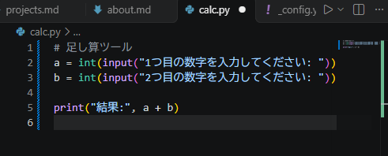

# Python ミニアプリ（Day9）

## 🧮 概要
簡単な計算アプリです。  
Python の基礎学習として作成しました。

## 🛠 使用技術
- Python
- VS Code

## 📄 コード
```python
# 足し算ツール
a = int(input("1つ目の数字を入力してください: "))
b = int(input("2つ目の数字を入力してください: "))

print("結果:", a + b)



## ✏ コメント
- 入力 → 計算 → 出力 の流れを理解するために作成。
- Python の基本構文（input, int, print）を練習できた。
- 今後は例外処理や GUI に挑戦したい。


---

# 🔗 次にやること（3ステップ）

## ① calc.md を保存（Ctrl + S）

## ② projects.md にリンクを追加

projects.md の Python ミニアプリの項目に：

・詳細ページ：calc.md

を追加。

## ③ Git に反映して push

