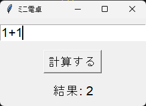

# Python ミニアプリ（Day20）ミニ電卓（GUI版）

## 🧮 概要
Python の tkinter を使って作成した GUI 電卓です。
入力欄に式を入れて「計算する」ボタンを押すと結果が表示されます。

## 🛠 使用技術
- Python
- VS Code
- tkinter（標準GUIライブラリ）

## 📄 コード
import tkinter as tk

def calculate():
    try:
        result = eval(entry.get())
        label_result.config(text=f"結果: {result}")
    except Exception:
        label_result.config(text="エラー: 計算できません")

root = tk.Tk()
root.title("ミニ電卓")

entry = tk.Entry(root, width=20, font=("Arial", 16))
entry.pack(pady=10)

button = tk.Button(root, text="計算する", command=calculate, font=("Arial", 14))
button.pack(pady=5)

label_result = tk.Label(root, text="結果: ", font=("Arial", 16))
label_result.pack(pady=10)

root.mainloop()

## スクリーンショット
 

## 💬 コメント
- tkinter を使って GUI の基本構造を理解できた。
- Entry（入力）、Button（ボタン）、Label（結果表示）を組み合わせて実装。
- GUI アプリを作ることで Python の応用力が大きく向上した。