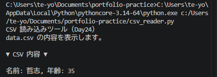

# Python ミニアプリ（Day24）CSV 読み込みツール

## 🧮 概要
Day23 で作成した data.csv を読み込み、名前と年齢を一覧表示するアプリです。
CSV は表形式データを扱えるため、Python のデータ処理の基礎として重要です。

## 🛠 使用技術
- Python
- VS Code
- csv モジュール（csv.reader）
- 例外処理（FileNotFoundError）

## 📄 コード
import csv

print("CSV 読み込みツール（Day24）")
print("data.csv の内容を表示します。\n")

try:
    with open("data.csv", "r", encoding="utf-8") as f:
        reader = csv.reader(f)
        rows = list(reader)

        if len(rows) == 0:
            print("CSV はまだ空です。")
        else:
            print("▼ CSV 内容 ▼\n")
            for row in rows:
                print(f"名前: {row[0]}, 年齢: {row[1]}")
except FileNotFoundError:
    print("data.csv が見つかりません。Day23 を先に実行してください。")

## 🖼 スクリーンショット

## 💬 コメント
- csv.reader を使って表形式データを読み込めるようになった。
- list(reader) で全行をまとめて扱える。
- ファイルがない場合は FileNotFoundError をキャッチ。
- Day23 とセットで「書く → 読む」の流れが完成した。