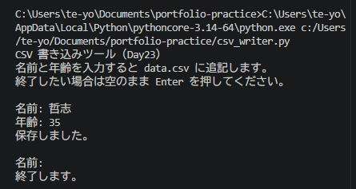

# Python ミニアプリ（Day23）CSV 書き込みツール

## 🧮 概要
名前と年齢を入力すると data.csv に追記するアプリです。
CSV は表形式データを扱えるため、Python のデータ処理の基礎として重要です。

## 🛠 使用技術
- Python
- VS Code
- csv モジュール（csv.writer）

## 📄 コード
import csv

print("CSV 書き込みツール（Day23）")
print("名前と年齢を入力すると data.csv に追記します。")
print("終了したい場合は空のまま Enter を押してください。\n")

with open("data.csv", "a", newline="", encoding="utf-8") as f:
    writer = csv.writer(f)

    while True:
        name = input("名前: ")
        if name == "":
            print("終了します。")
            break

        age = input("年齢: ")
        if age == "":
            print("終了します。")
            break

        writer.writerow([name, age])
        print("保存しました。\n")

## 🖼 スクリーンショット

## 💬 コメント
- csv.writer を使って表形式データを扱えるようになった。
- newline="" を指定して余計な空行を防止。
- UTF-8 で日本語を安全に扱える。
- テキストより構造化されたデータを扱うことで、AIエージェントの学習データにも応用できる。