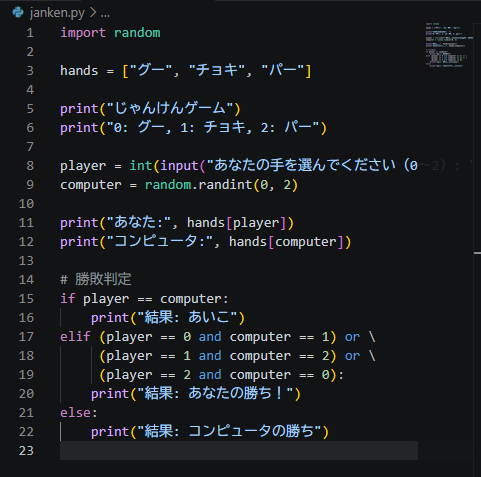

# Python ミニアプリ（Day16）じゃんけんゲーム

## 🧮 概要
Python の random と条件分岐を使ったじゃんけんゲームです。

## 🛠 使用技術
- Python
- VS Code
- random モジュール

## 📄 コード
（ここに janken.py のコードを貼る）

## ✏ コメント
- random を使ってコンピュータの手を生成。
- 条件分岐で勝敗判定を実装。
- Python の基礎構文を総合的に練習できた。