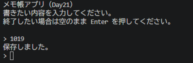

# Python ミニアプリ（Day21）メモ帳（ファイル書き込み）

## 🧮 概要
Python のファイル書き込み機能を使ったシンプルなメモ帳アプリです。
入力した内容が memo.txt に追記され、終了後も内容が残ります。

## 🛠 使用技術
- Python
- VS Code
- ファイル操作（open, write）

## 📄 コード

print("メモ帳アプリ（Day21）")
print("書きたい内容を入力してください。")
print("終了したい場合は空のまま Enter を押してください。\n")

with open("memo.txt", "a", encoding="utf-8") as f:
    while True:
        text = input("> ")
        if text == "":
            print("メモを保存して終了します。")
            break
        f.write(text + "\n")
        print("保存しました。")

## 🖼 スクリーンショット

## 💬 コメント
- open("memo.txt", "a") で追記モードを使用。
- UTF-8 指定で文字化けを防止。
- 空行で終了する CLI アプリらしい操作性。
- ファイルに書き込むことで「永続化」を体験できた。