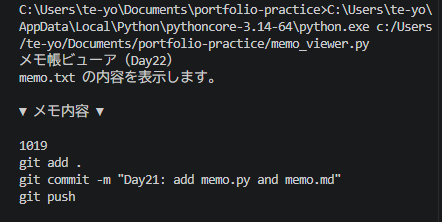

# Python ミニアプリ（Day22）メモ帳ビューア（ファイル読み込み）

## 🧮 概要
Day21 で作成した memo.txt を読み込んで内容を表示するアプリです。
ファイルが存在しない場合は例外処理で安全に対応します。

## 🛠 使用技術
- Python
- VS Code
- ファイル操作（open, read）
- 例外処理（FileNotFoundError）

## 📄 コード
print("メモ帳ビューア（Day22）")
print("memo.txt の内容を表示します。\n")

try:
    with open("memo.txt", "r", encoding="utf-8") as f:
        content = f.read()
        if content.strip() == "":
            print("メモはまだありません。")
        else:
            print("▼ メモ内容 ▼\n")
            print(content)
except FileNotFoundError:
    print("memo.txt が見つかりません。Day21 を先に実行してください。")

## 🖼 スクリーンショット

## 💬 コメント
- open("memo.txt", "r") で読み込みモードを使用。
- ファイルが存在しない場合は FileNotFoundError をキャッチ。
- Day21 のメモ帳とセットで「書く → 読む」の流れを理解できた。
- 永続化の基礎が身についた。