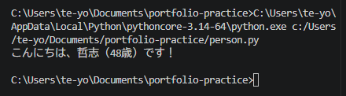

# Python ミニアプリ（Day25）Person クラス（OOP 入門）

## 🧮 概要
Python のクラス（OOP）の基礎として、Person クラスを定義し、
インスタンスを生成してメソッドを呼び出す仕組みを学びました。

## 🛠 使用技術
- Python
- VS Code
- クラス（class）
- コンストラクタ（__init__）
- メソッド（greet）

## 📄 コード
class Person:
    def __init__(self, name, age):
        self.name = name
        self.age = age

    def greet(self):
        return f"こんにちは、{self.name}（{self.age}歳）です！"

# --- ここから実行部分 ---
p = Person("哲志", 48)
print(p.greet())

## 🖼 スクリーンショット

## 💬 コメント
- クラスの基本構造（class → init → メソッド）を理解できた。
- self の役割が「インスタンス自身」を指すことを体感できた。
- AIエージェント構築で必須となる「状態を持つオブジェクト」の基礎が身についた。