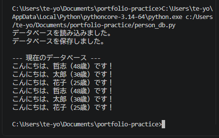

# Python ミニアプリ（Day30）PersonDB（簡易データベース）

## 🧮 概要
Person クラスと PersonDB クラスを組み合わせて、
「追加 → 保存 → 読み込み」を行う簡易データベースを構築しました。
AIエージェントのメモリ管理（保存・復元・更新）の原型となる重要なステップです。

## 🛠 使用技術
- Python
- VS Code
- クラス（Person / PersonDB）
- JSON 保存・読み込み
- 例外処理（FileNotFoundError）
- データベース設計（追加・保存・読み込み）

## 📄 コード
import json

class Person:
    def __init__(self, name, age):
        self.name = name
        self.age = int(age)

    def to_dict(self):
        return {"name": self.name, "age": self.age}

    def greet(self):
        return f"こんにちは、{self.name}（{self.age}歳）です！"

class PersonDB:
    def __init__(self, filename="person_db.json"):
        self.filename = filename
        self.people = []

    # --- 追加 ---
    def add(self, person):
        self.people.append(person)

    # --- 保存 ---
    def save(self):
        data = [p.to_dict() for p in self.people]
        with open(self.filename, "w", encoding="utf-8") as f:
            json.dump(data, f, ensure_ascii=False, indent=2)
        print("データベースを保存しました。")

    # --- 読み込み ---
    def load(self):
        try:
            with open(self.filename, "r", encoding="utf-8") as f:
                data = json.load(f)
                self.people = [Person(item["name"], item["age"]) for item in data]
            print("データベースを読み込みました。")
        except FileNotFoundError:
            print("データベースファイルがありません。新規作成します。")

# --- 実行部分 ---
db = PersonDB()

# 既存データ読み込み
db.load()

# 新規追加
db.add(Person("哲志", 48))
db.add(Person("太郎", 30))
db.add(Person("花子", 25))

# 保存
db.save()

# 表示
print("\n--- 現在のデータベース ---")
for p in db.people:
    print(p.greet())

## 🖼 スクリーンショット

## 💬 コメント
- Person と PersonDB の2クラス構成で「追加・保存・読み込み」を実装できた。
- JSON を使った柔軟なデータ管理の基礎が身についた。
- ファイルがない場合の例外処理で、実践的なアプリ設計を体験できた。
- AIエージェントのメモリ管理（保存・復元・更新）の原型が完成した。