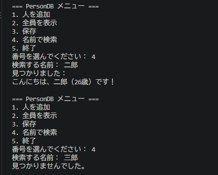

# Python ミニアプリ（Day32）PersonDB 検索機能付きデータベース

## 🧮 概要
PersonDB に検索機能（find）を追加し、
名前で人物を検索できる対話型データベースアプリを構築しました。
AIエージェントの「メモリ検索」の基礎となる重要なステップです。

## 🛠 使用技術
- Python
- VS Code
- クラス（Person / PersonDB）
- JSON 保存・読み込み
- 対話ループ（while True）
- ユーザー入力（input）
- 検索機能（find）

## 📄 コード
import json

class Person:
    def __init__(self, name, age):
        self.name = name
        self.age = int(age)

    def to_dict(self):
        return {"name": self.name, "age": self.age}

    def greet(self):
        return f"こんにちは、{self.name}（{self.age}歳）です！"

class PersonDB:
    def __init__(self, filename="person_db.json"):
        self.filename = filename
        self.people = []

    def add(self, person):
        self.people.append(person)

    def save(self):
        data = [p.to_dict() for p in self.people]
        with open(self.filename, "w", encoding="utf-8") as f:
            json.dump(data, f, ensure_ascii=False, indent=2)
        print("データベースを保存しました。\n")

    def load(self):
        try:
            with open(self.filename, "r", encoding="utf-8") as f:
                data = json.load(f)
                self.people = [Person(item["name"], item["age"]) for item in data]
            print("データベースを読み込みました。\n")
        except FileNotFoundError:
            print("データベースファイルがありません。新規作成します。\n")

    # --- 検索機能 ---
    def find(self, name):
        for p in self.people:
            if p.name == name:
                return p
        return None

# --- メニュー操作 ---
db = PersonDB()
db.load()

while True:
    print("=== PersonDB メニュー ===")
    print("1. 人を追加")
    print("2. 全員を表示")
    print("3. 保存")
    print("4. 名前で検索")
    print("5. 終了")
    choice = input("番号を選んでください： ")

    if choice == "1":
        name = input("名前： ")
        age = input("年齢： ")
        db.add(Person(name, age))
        print("追加しました。\n")

    elif choice == "2":
        print("\n--- 登録されている人 ---")
        for p in db.people:
            print(p.greet())
        print()

    elif choice == "3":
        db.save()

    elif choice == "4":
        name = input("検索する名前： ")
        result = db.find(name)
        if result:
            print("見つかりました：")
            print(result.greet(), "\n")
        else:
            print("見つかりませんでした。\n")

    elif choice == "5":
        print("終了します。")
        break

    else:
        print("無効な入力です。\n")
## 🖼 スクリーンショット

## 💬 コメント
- 名前検索（find）を実装し、メモリ検索の基礎を理解できた。
- 見つかった場合と見つからない場合の分岐処理を体験できた。
- PersonDB が「追加・表示・保存・読み込み・検索」のフル機能を持つミニDBになった。
- AIエージェントのメモリ検索の原型が完成した。