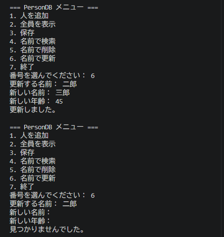

# Python ミニアプリ（Day34）PersonDB 更新機能付きデータベース

## 🧮 概要
PersonDB に更新機能（update）を追加し、
名前を指定して人物情報（名前・年齢）を更新できる対話型データベースアプリを構築しました。
CRUD（Create / Read / Update / Delete）の “U” が完成し、
AIエージェントのメモリ管理（更新）の基礎となる重要なステップです。

## 🛠 使用技術
- Python
- VS Code
- クラス（Person / PersonDB）
- JSON 保存・読み込み
- 対話ループ（while True）
- ユーザー入力（input）
- 更新機能（update）

## 📄 コード
import json

class Person:
    def __init__(self, name, age):
        self.name = name
        self.age = int(age)

    def to_dict(self):
        return {"name": self.name, "age": self.age}

    def greet(self):
        return f"こんにちは、{self.name}（{self.age}歳）です！"

class PersonDB:
    def __init__(self, filename="person_db.json"):
        self.filename = filename
        self.people = []

    def add(self, person):
        self.people.append(person)

    def save(self):
        data = [p.to_dict() for p in self.people]
        with open(self.filename, "w", encoding="utf-8") as f:
            json.dump(data, f, ensure_ascii=False, indent=2)
        print("データベースを保存しました。\n")

    def load(self):
        try:
            with open(self.filename, "r", encoding="utf-8") as f:
                data = json.load(f)
                self.people = [Person(item["name"], item["age"]) for item in data]
            print("データベースを読み込みました。\n")
        except FileNotFoundError:
            print("データベースファイルがありません。新規作成します。\n")

    # --- 検索 ---
    def find(self, name):
        for p in self.people:
            if p.name == name:
                return p
        return None

    # --- 削除 ---
    def delete(self, name):
        for p in self.people:
            if p.name == name:
                self.people.remove(p)
                return True
        return False

    # --- 更新 ---
    def update(self, name, new_name, new_age):
        person = self.find(name)
        if person:
            person.name = new_name
            person.age = int(new_age)
            return True
        return False

# --- メニュー操作 ---
db = PersonDB()
db.load()

while True:
    print("=== PersonDB メニュー ===")
    print("1. 人を追加")
    print("2. 全員を表示")
    print("3. 保存")
    print("4. 名前で検索")
    print("5. 名前で削除")
    print("6. 名前で更新")
    print("7. 終了")
    choice = input("番号を選んでください： ")

    if choice == "1":
        name = input("名前： ")
        age = input("年齢： ")
        db.add(Person(name, age))
        print("追加しました。\n")

    elif choice == "2":
        print("\n--- 登録されている人 ---")
        for p in db.people:
            print(p.greet())
        print()

    elif choice == "3":
        db.save()

    elif choice == "4":
        name = input("検索する名前： ")
        result = db.find(name)
        if result:
            print("見つかりました：")
            print(result.greet(), "\n")
        else:
            print("見つかりませんでした。\n")

    elif choice == "5":
        name = input("削除する名前： ")
        if db.delete(name):
            print("削除しました。\n")
        else:
            print("見つかりませんでした。\n")

    elif choice == "6":
        name = input("更新する名前： ")
        new_name = input("新しい名前： ")
        new_age = input("新しい年齢： ")
        if db.update(name, new_name, new_age):
            print("更新しました。\n")
        else:
            print("見つかりませんでした。\n")

    elif choice == "7":
        print("終了します。")
        break

    else:
        print("無効な入力です。\n")

## 🖼 スクリーンショット

## 💬 コメント
- 更新機能（update）を実装し、CRUD の “U” を理解できた。
- find → 更新 → 保存 の流れを体験できた。
- PersonDB が「追加・表示・保存・読み込み・検索・削除・更新」の完全な CRUD データベースになった。
- AIエージェントのメモリ管理（更新）の原型が完成した。