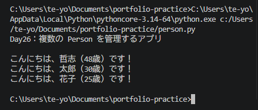

# Python ミニアプリ（Day26）複数の Person を管理するアプリ

## 🧮 概要
Person クラスを複数インスタンス化し、リストで管理して全員の自己紹介を表示するアプリです。
クラスとデータ構造（リスト）の組み合わせを理解する重要なステップです。

## 🛠 使用技術
- Python
- VS Code
- クラス（class）
- コンストラクタ（__init__）
- メソッド（greet）
- リスト（複数インスタンス管理）

## 📄 コード
class Person:
    def __init__(self, name, age):
        self.name = name
        self.age = age

    def greet(self):
        return f"こんにちは、{self.name}（{self.age}歳）です！"

# --- 複数インスタンスを作成 ---
people = [
    Person("哲志", 48),
    Person("太郎", 30),
    Person("花子", 25)
]

# --- 全員の自己紹介を表示 ---
print("Day26：複数の Person を管理するアプリ\n")

for p in people:
    print(p.greet())

## 🖼 スクリーンショット

## 💬 コメント
- 複数インスタンスをリストで管理する方法を理解できた。
- for ループでオブジェクトを順番に処理する流れが自然に書けた。
- クラスを「1つのデータ型」として扱う感覚が身についた。
- AIエージェントの「複数タスク・複数メモリ管理」の基礎になる。