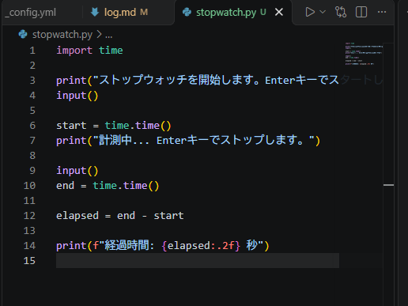

# Python ミニアプリ（Day19）ストップウォッチ

## 🧮 概要
Python の time.time を使って経過時間を計測するストップウォッチです。

## 🛠 使用技術
- Python
- VS Code
- time モジュール

## 📄 コード

import time

print("ストップウォッチを開始します。Enterキーでスタートします。")
input()

start = time.time()
print("計測中... Enterキーでストップします。")

input()
end = time.time()

elapsed = end - start

print(f"経過時間: {elapsed:.2f} 秒")

## スクリーンショット

## コメント
- time.time を使って現在時刻を取得。
- 開始時刻と終了時刻の差で経過時間を計算。
- タイマーとは異なる「時間の扱い方」を学べた。