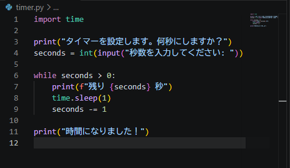

# Python ミニアプリ（Day17）タイマー

## 🧮 概要
Python の time.sleep と while ループを使ったカウントダウンタイマーです。

## 🛠 使用技術
- Python
- VS Code
- time モジュール

## 📄 コード

## 💬 コメント
- time.sleep を使って1秒ごとに処理を遅延。
- while ループでカウントダウンを実装。
- Python の基礎構文を総合的に練習できた。