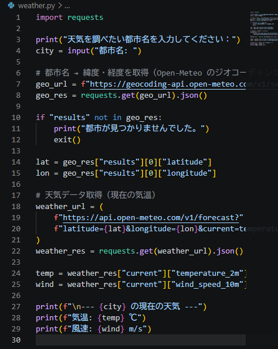

# Python ミニアプリ（Day18）天気API

## 🧮 概要
Open-Meteo の API を使って、都市名から現在の気温と風速を取得するアプリです。
APIキー不要で使えるため、学習用に最適です。

## 🛠 使用技術
- Python
- VS Code
- requests モジュール
- Open-Meteo API（ジオコーディング + 天気API）

## 📄 コード
import requests

print("天気を調べたい都市名を入力してください：")
city = input("都市名: ")

# 都市名 → 緯度・経度を取得
geo_url = f"https://geocoding-api.open-meteo.com/v1/search?name={city}&count=1"
geo_res = requests.get(geo_url).json()

if "results" not in geo_res:
    print("都市が見つかりませんでした。")
    exit()

lat = geo_res["results"][0]["latitude"]
lon = geo_res["results"][0]["longitude"]

# 天気データ取得
weather_url = (
    f"https://api.open-meteo.com/v1/forecast?"
    f"latitude={lat}&longitude={lon}&current=temperature_2m,wind_speed_10m"
)
weather_res = requests.get(weather_url).json()

temp = weather_res["current"]["temperature_2m"]
wind = weather_res["current"]["wind_speed_10m"]

print(f"\n--- {city} の現在の天気 ---")
print(f"気温: {temp} ℃")
print(f"風速: {wind} m/s")

## スクリーンショット

## コメント
- APIキー不要の Open-Meteo を使用。
- ジオコーディングで都市名から緯度・経度を取得。
- requests を使って API から JSON を取得し、値を抽出。
- Python で外部サービスと連携する基礎を学べた。

